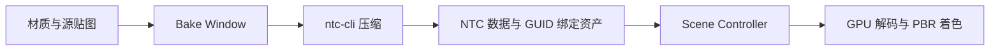

# NTCinUnity

基于 NVIDIA RTXNTC 的 Unity URP 神经纹理压缩插件，提供材质纹理烘焙、压缩资产管理、GPU 解码和 PBR 材质采样。

NTC 将同一材质的多张纹理及其 mip 链联合编码为特征网格与小型神经网络，在访问纹理时重建所需通道。算法参考 SIGGRAPH 2023 论文 [Random-Access Neural Compression of Material Textures](https://research.nvidia.com/labs/rtr/neural_texture_compression/)，离线训练使用 [NVIDIA RTXNTC](https://github.com/NVIDIA-RTX/RTXNTC)。

## 功能

- **材质烘焙**：扫描场景材质，提取纹理与通道配置，调用 `ntc-cli` 批量压缩。
- **资产绑定**：通过材质 GUID 和 local ID 管理压缩数据、材质模板及 Renderer 材质槽。
- **PBR 直接采样**：在统一纹理组入口解码 BaseColor、Normal、Metallic、Roughness、AO 和 Alpha。
- **采样设置**：保存各贴图的寻址模式、过滤方式、各向异性等级和 mip bias。
- **资源管理**：管理 latent、权重及解码缓存，支持原材质恢复和原图引用释放。

Direct 使用 URP/Lit 的 Metallic 工作流，支持不透明和 Alpha Clip 材质。其余材质保留原材质。

## 工作流程



运行时提供四种模式：

| 模式 | 实现 |
| --- | --- |
| `Original` | 使用原始材质 |
| `InferenceOnLoad` | 通过 Compute Shader 解压完整 PBR 贴图 |
| `InferenceOnSample` | 根据可见性和预算分帧解压 tile 到缓存 |
| `InferenceOnSampleDirect` | 在 fragment shader 访问纹理组时执行推理 |

Unity Runtime 使用 C# 和 shader 实现，不依赖 CUDA、`ntc-cli` 或原生 NTC DLL。

## 环境

- Unity 2021.3、URP 12
- Windows x64、Direct3D 12
- 离线烘焙：NVIDIA `ntc-cli`、Python、Pillow

## 快速开始

```bash
git clone --recursive https://github.com/kiiye9697/NTCinUnity.git
```

1. 将 `unity-plugin` 完整复制到 URP 工程的 `Assets/NtcPlugin`，保留 `.meta`；也可通过 Package Manager 安装其 `package.json`。
2. 按 [RTXNTC 构建说明](https://github.com/NVIDIA-RTX/RTXNTC/blob/1cfa9a514d1b893754df0d343e0dd9cf5a11567d/README.md) 准备 `ntc-cli`，安装 Python 图像处理依赖：

   ```bash
   python -m pip install pillow
   ```

3. 保存源材质，打开 `NTC / Bake Window`，设置工具路径，扫描并烘焙材质。
4. 使用 `NTC / Add Scene Controller` 添加控制器；烘焙或修改材质后使用 `NTC / Rescan Scene Materials` 重新扫描并保存场景。
5. 进入 Play，通过控制面板切换运行模式。

烘焙会生成 `Assets/NtcBindings` 绑定资产、`StreamingAssets/NtcData` 数据文件，以及用于恢复原材质的 `Resources/NtcOriginals` 资产。项目中的示例美术和生成数据由使用者自行提供。

详细配置见 [使用说明](docs/使用说明.md)，运行时结构见 [实现说明](docs/实现说明.md)。

## 工程结构

| 目录 | 内容 |
| --- | --- |
| `unity-plugin/Runtime` | NTEX 解析、GPU 资产、材质绑定与资源管理 |
| `unity-plugin/Editor` | 烘焙窗口、资产发布、场景配置与构建工具 |
| `unity-plugin/Shaders` | NTC 推理、统一纹理组采样与 URP PBR shader |
| `unity-plugin/Resources` | Compute 解码 kernel |
| `unity-plugin/Tests` | 容器、材质、采样及资源管理测试 |
| `tools` | 项目准备、测试、运行和插件打包脚本 |
| `nvidia-backend` | 固定版本的 NVIDIA RTXNTC 子模块 |

## 参考文献

Karthik Vaidyanathan, Marco Salvi, Bartlomiej Wronski, Tomas Akenine-Möller, Pontus Ebelin, and Aaron Lefohn. **Random-Access Neural Compression of Material Textures.** Proceedings of SIGGRAPH, 2023.

[论文主页](https://research.nvidia.com/labs/rtr/neural_texture_compression/) · [论文 PDF](https://research.nvidia.com/labs/rtr/neural_texture_compression/assets/ntc_medium_size.pdf) · [官方实现](https://github.com/NVIDIA-RTX/RTXNTC)

```bibtex
@inproceedings{ntc2023,
    author = {Vaidyanathan, Karthik and Salvi, Marco and Wronski, Bartlomiej and Akenine-Möller, Tomas and Ebelin, Pontus and Lefohn, Aaron},
    title = {Random-Access Neural Compression of Material Textures},
    year = {2023},
    booktitle = {Proceedings of SIGGRAPH}
}
```

## License

项目代码采用 [NTCinUnity Research and Evaluation License](LICENSE)。NVIDIA RTXNTC 及其衍生 shader 适用对应的 NVIDIA 许可，详见 [THIRD-PARTY-NOTICES.md](THIRD-PARTY-NOTICES.md)。
