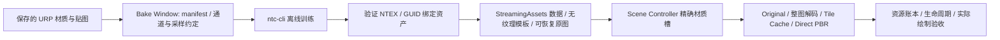

# NTCinUnity

Unity URP 的 NVIDIA Neural Texture Compression 接入工具，覆盖离线烘焙、资产发布、运行时 PBR 采样、资源回收和 Player 验证。NVIDIA 后端通过固定版本的 Git submodule 提供；Unity Runtime 不依赖 CUDA、ntc-cli 或原生 NTC DLL。

## 当前能用到什么程度

在 **Unity 2021.3.33f1 / URP 12.1.13 / Windows x64 D3D12 / RTX 5080 / Linear** 下验证。标准 URP/Lit 不透明、Alpha Clip 的 Metallic 材质可使用完整 PBR Direct；透明、视差、Specular、detail、clear coat、纹理 emission 等功能明确回退原材质。当前 Sponza 24 组中 22 组 Direct、2 组回退。

当前回归包含 58 项 EditMode 检查，涵盖实际 fragment、stock URP Lit 对照、推理数值、材质开关、采样、绑定和显存估算。独立 Player 证明共享消费者保护、原图回收与恢复，以及实际材质出图。**这仍是研究与评估实现：完整场景帧性能、清除驱动缓存后的首次使用成本、其他 GPU/URP 版本尚待验收。**

本机小材质探针首次绘制加同步回读 496ms，再次 3.1ms；驱动磁盘缓存未清除，这不是 GPU frame time。当前场景 Direct 估算纹理和 NTC 缓冲为 109.2MiB，Original 为 86.3MiB，不能据此宣称净省显存。

## 完整链路



Direct 在纹理组访问入口进行推理，一次网络输出提供 BaseColor、Normal、Metallic、Roughness、AO 和 Alpha。采样角色可共享结果；滤波循环共用解码调用点，控制首次驱动编译展开量。它采用可移植 shader 数学，没有验证 Tensor/CoopVec 或硬件 DP4A 指令路径。

| 模式 | 工作方式 | 用途 |
| --- | --- | --- |
| Original | 原始材质与贴图 | 对照与明确回退 |
| InferenceOnLoad | Compute 解压完整 PBR 贴图 | 数值/画面验证，解码缓存可能很大 |
| InferenceOnSample | 按可见性和预算解压 tile 到 PBR cache | 分帧加载；名称沿用旧版本 |
| InferenceOnSampleDirect | fragment 访问时推理完整材质通道 | 标准 URP/Lit Direct 路径，无完整解码缓存 |

旧 BaseColor Unlit shader 只用于兼容诊断，不代表完整 PBR Direct。

## 安装和首次使用

仅使用 Unity 包无需拉取 NVIDIA 子模块；离线烘焙时才需要构建后端。

```bash
git clone --recursive https://github.com/kiiye9697/NTCinUnity.git
```

1. 在 URP 工程中通过 Package Manager 安装 `unity-plugin/package.json`，或将完整目录连同 `.meta` 复制到 `Assets/NtcPlugin`。不要两种方式同时安装。
2. 按 [NVIDIA 后端说明](nvidia-backend/README.md) 构建 `ntc-cli`，准备支持 Pillow 的 Python。
3. 保存源材质资产，在 `NTC / Bake Window` 扫描并烘焙。成功后自动发布 GUID/localId 绑定、StreamingAssets 数据、无纹理模板与 Resources 恢复材质；支持单张输入图。
4. `NTC / Add Scene Controller` 或 `NTC / Rescan Scene Materials`，保存场景，检查准确槽位和不支持原因。新烘焙完成后需要重新扫描并保存。
5. 先在 Original 对照，再切换目标模式。确认数据、shader 引用及绑定资产进入 Player，完成生命周期、实际绘制和目标设备性能验证。

详细设置与输出约定见 [使用说明](docs/使用说明.md) 和 [接入契约](docs/INTEGRATION.md)。示例 Sponza 美术、烘焙 NtcData 和本机 Showcase 工程不随仓库发布；公共 clone 可安装插件，在自己的 URP 工程和素材上烘焙。

## 工程与工具

| 位置 | 职责 |
| --- | --- |
| [unity-plugin/Runtime](unity-plugin/Runtime) | 容器校验、GPU 资产、统一材质绑定、模式与资源生命周期 |
| [unity-plugin/Shaders](unity-plugin/Shaders) / [Resources](unity-plugin/Resources) | 完整 PBR Direct、推理、compute 解码和调试 |
| [unity-plugin/Editor](unity-plugin/Editor) | 烘焙、GUID 发布、场景扫描和验收构建 |
| [unity-plugin/Tests](unity-plugin/Tests) | 无需美术的合约测试及需外部语料/GPU 的回归 |
| [tools](tools) | 可重复准备、测试、构建、运行和打包入口 |
| [docs](docs/README.md) | 使用、架构、验收方法与已知边界 |
| [nvidia-backend](nvidia-backend) | 固定版本 NVIDIA RTXNTC 子模块，负责离线训练 |

```powershell
# 外部25文件语料不随仓库提供；具体要求见 Tests/README.md
.\tools\Run-NtcEditModeTests.ps1 -UnityEditor '<Unity.exe>' -Corpus '<corpus>'
```

Showcase 工具面向本地已有场景；不自动下载第三方美术。[工具说明](tools/README.md) 给出参数、前置条件、成功标准和产物边界。

## 文档与许可

[接入与契约](docs/INTEGRATION.md) · [技术说明](docs/技术报告.md) · [验证记录](docs/验证记录.md) · [基准方法](docs/BENCHMARK.md)

本仓库采用 [NTCinUnity Research and Evaluation License](LICENSE)。NVIDIA 子模块及衍生 shader 的条款见 [THIRD-PARTY-NOTICES.md](THIRD-PARTY-NOTICES.md)，不能将此实现视为不受限制的生产许可证。
