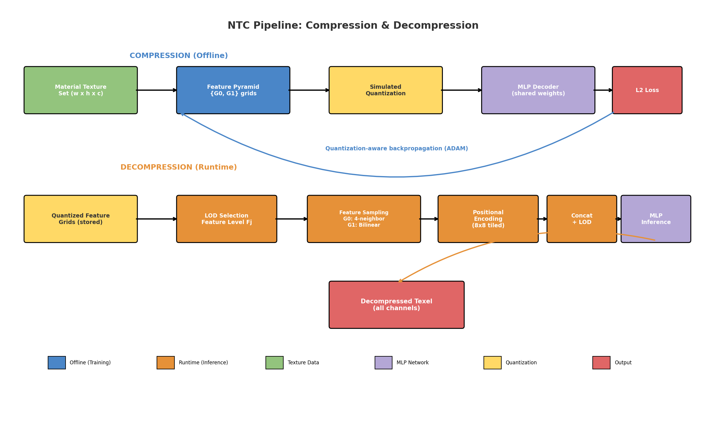
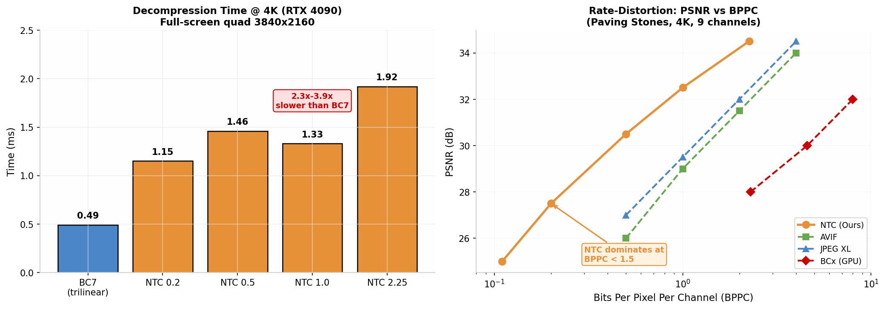

# 浅析NVIDIA神经纹理压缩(NTC)——从论文到Unity插件落地实践

> 阅读提示：本文针对 NVIDIA SIGGRAPH 2023 论文《Random-Access Neural Compression of Material Textures》进行深度解耦，并在此基础上加入完整的 **Unity 插件落地实践** 章节，涵盖方法论、架构设计、烘焙工具链、打包发布约束、效果对比及踩坑实录。

---

## 1. Introduction

### 1.1 传统方案的缺陷 (The Pain)

GPU 纹理压缩自 1990 年代末诞生以来，核心技术栈几乎未曾改变。以 BC1-BC7 (S3TC)、ASTC、ETC 为代表的块压缩格式，将 4x4 像素块编码为固定长度的比特流，依赖专用硬件实现快速随机访问。这些格式具备三项工业级优势：常数时间随机解码、与纹理过滤管线无缝集成、极低显存占用。

然而，块压缩的 bitrate 被锁死在 4-8 BPP (Bits Per Pixel)，面对当代渲染的两项核心需求已显乏力：

1. **多通道材质数据膨胀**。现代 PBR 材质通常包含 9-16 个通道 (albedo RGB + normal XYZ + roughness + metalness + AO + opacity)，块压缩要求每份纹理独立存储，无法跨通道共享信息。即便采用 BC7 的 8 BPP，一套 4K PBR 材质也需约 48-85 MB 显存。

2. **低 bitrate 下质量崩塌**。块压缩假设每个 4x4 块内的颜色分布在 1-2 条直线上，该假设在极高分辨率纹理和低频渐变区域严重失效，产生可见的块效应和色带 (banding)。

图像压缩标准 (AVIF、JPEG XL) 虽能在低 bitrate 下保持更高质量，但它们依赖全局变换和熵编码，**不具备随机访问能力**，无法集成到实时渲染的采样管线中。神经图像压缩方法虽改善了感知质量，但同样缺乏随机访问支持，且需要大规模数据集预训练。

### 1.2 本文的解决方法 (The Solution)

NTC (Neural Texture Compression) 提出了一套专为材质纹理设计的神经压缩框架，核心洞察是：**同一材质的不同通道 (如 albedo 与 normal) 以及不同 mipmap 级别之间存在高度相关性**，而块压缩完全忽略这些跨维度冗余。

NTC 的压缩表示是一个**量化特征网格金字塔**，每个特征级别包含一对高低分辨率网格 (G0, G1)。解码时，从网格中采样特征向量，连同位置编码和 LOD 值送入一个**小型 MLP** (2 隐藏层 x 64 通道)，实时重建目标 texel 的所有通道值。

关键突破点：

- **跨通道联合压缩**：同时压缩 albedo、normal、roughness、AO 等全部通道，利用通道间相关性将存储降低至传统方案的 1/5 至 1/16
- **跨 mipmap 特征复用**：单个特征级别预测 2-4 个 mipmap 级别，将 mipmap 链的存储开销从 33% 降至约 6.7%
- **随机访问保证**：每个 texel 的解码仅依赖局部特征网格采样，计算复杂度 O(1)，可直接嵌入 pixel shader 或 ray tracing hit shader
- **确定性解码**：非生成式，相同输入永远产生相同输出，满足渲染管线对可复现性的严格要求

论文的旗舰数据：NTC 0.2 配置以 **3.8 MB** 存储 (对比 BC high 的 5.3 MB) 提供了 **4x 更高分辨率** (16x texel 数量)，同时 PSNR 从 19.4 dB 提升至 22.0 dB。

---

## 2. KeyWords

| 关键词 (Academic) | 简单解释 | 在本算法中的具体职责 |
| :--- | :--- | :--- |
| Feature Pyramid | 多分辨率特征网格的层次结构，类似图像金字塔但存储的是学习的潜在特征而非像素值 | 构成压缩表示的主体。每个级别 Fj 包含 G0(高分辨率) 和 G1(低分辨率) 两个量化特征网格，解码时根据 LOD 选择对应级别 |
| Simulated Quantization | 训练时通过添加均匀噪声模拟量化误差，而非真正执行量化 | 在反向传播中保持梯度流，使特征网格适应离散值。训练末期冻结量化后的网格，继续微调 MLP 权重 5% 的步数 |
| Tiled Positional Encoding | 基于三角波的周期性位置编码，以 8x8 texel 为周期平铺 | 为 MLP 提供高频相位信息，补偿特征网格上采样时的分辨率不足。仅需 12 个标量 (6+6 水平和垂直) |
| hardGELU | GELU 激活函数的分段线性近似：0 (x < -1.5), x (x > 1.5), x/3*(x+1.5) (otherwise) | 替代标准 GELU 用于 MLP 隐藏层，减少渲染 shader 中的 ALU 指令数，实测无质量损失 |
| Autodecoder | 不使用编码器，直接优化潜在表示 (特征网格) + 解码器 (MLP) 的联合框架 | 每个材质独立训练：特征网格存储材质特异性信息，MLP 学习从特征到像素值的非线性映射 |
| Stochastic Texture Filtering | 在 texel 坐标上添加随机抖动 (jitter) 后点采样，依赖 TAA/DLSS 做时域重建 | 解决 NTC 逐 texel 解码无法直接做双/三线性过滤的问题，避免了解码 8 个 texel 的 8x 开销 |

---

## 3. Technical Breakdown

### 3.1 为什么最终是求解线性系统

NTC 的核心不是求解传统的 $Ax = b$ 线性系统，而是**端到端优化一个量化自编码器**：通过梯度下降联合优化特征网格 (latent) 和 MLP 权重。从实现角度看，可将训练过程分解为两个耦合的线性代数阶段：

1. **前向传播 (解码)**：特征采样 + MLP 矩阵乘法，计算重建损失
2. **反向传播 (编码)**：通过链式法则将像素误差反向传播到特征网格和权重，执行参数更新

### 3.2 阶段一：特征网格采样与拼接

**输入**：纹理坐标 $(u, v)$，目标 mipmap 级别 $lod$

**特征级别选择**：根据 $lod$ 查表选择特征级别 $F_j$。以 1024x1024 纹理为例 (Table 1)：

| Feature level $F_j$ | $G_0$ resolution | $G_1$ resolution | Predicted mip levels |
| :--- | :--- | :--- | :--- |
| 0 | 256 x 256 | 128 x 128 | 0, 1, 2, 3 |
| 1 | 64 x 64 | 32 x 32 | 4, 5 |
| 2 | 16 x 16 | 8 x 8 | 6, 7 |
| 3 | 4 x 4 | 2 x 2 | 8, 9, 10 |

**采样操作** (Section 4.3.1)：

- **高分辨率网格 $G_0$**：取目标位置的四邻域特征向量 (4 vectors)，不做插值，直接拼接 (concatenate)
- **低分辨率网格 $G_1$**：对目标位置做一次双线性采样 (1 vector)

**设计动机**：$G_0$ 的 learned interpolation (拼接后由 MLP 学习组合权重) 保留高频细节；$G_1$ 的双线性插值提供低频平滑信号，抑制量化导致的色带。

**输出维度**：设 $G_0$ 通道数为 $C_0$，$G_1$ 通道数为 $C_1$，则采样后的特征向量为：

$$f_{sampled} = concat(\underbrace{f_{G0}^{00}, f_{G0}^{01}, f_{G0}^{10}, f_{G0}^{11}}_{4C_0}, \underbrace{f_{G1}}_{C_1})$$

### 3.3 阶段二：MLP 解码

**网络架构** (Section 4.4)：

$$\hat{c} = W_3 \cdot \text{hardGELU}(W_2 \cdot \text{hardGELU}(W_1 \cdot x_{in} + b_1) + b_2) + b_3$$

| 层 | 输入维度 | 输出维度 | 操作 |
| :--- | :--- | :--- | :--- |
| Input | $4C_0 + C_1 + 12 + 1$ | - | 拼接：4x G0 特征 + G1 特征 + 12 维位置编码 + 1 维归一化 LOD |
| Hidden 1 | $4C_0 + C_1 + 13$ | 64 | 线性 + hardGELU |
| Hidden 2 | 64 | 64 | 线性 + hardGELU |
| Output | 64 | $N_{channels}$ | 线性 (无激活) |

**位置编码计算** (Section 4.3.2)：

对 texel 在 8x8 tile 内的局部坐标 $p \in [0, 1]$，使用三角波代替正弦/余弦：

$$\text{tri}(p, f) = |2 \cdot \text{frac}(p \cdot f) - 1|$$

其中 $f$ 为频率 (octave)，取 $f = 1, 2, 4, 8$ (即 $\log_2 8 = 3$ 个 octave)，水平和垂直各 6 个标量，共 12 维。

### 3.4 阶段三：量化感知训练

**量化模拟** (Section 4.2)：

训练迭代 $t$ 时，向特征网格添加均匀噪声：

$$\tilde{G}_k = G_k + \epsilon, \quad \epsilon \sim U\left(-\frac{Q_k}{2}, \frac{Q_k}{2}\right)$$

**两阶段训练策略**：

1. 阶段一 (95% 步数)：加噪声训练，特征网格和 MLP 权重联合优化
2. 阶段二 (5% 步数)：冻结量化后的特征网格，仅微调 MLP 权重适配离散值

### 3.5 系统属性对比总结

| 属性 | 特征网格 (G0, G1) | MLP 解码器 |
| :--- | :--- | :--- |
| 存储内容 | 量化后的低维潜在特征 | 每层权重矩阵 + 偏置 |
| 数据类型 | int4/int8 (量化后) | float16 (推理) |
| 每材质参数量 | 取决于分辨率和通道数 | ~40-80 KB (2x64 hidden) |
| 训练时更新 | 是 (ADAM, lr=0.01) | 是 (ADAM, lr=0.005) |
| 推理时更新 | 否 | 否 |
| 跨 mipmap 共享 | 是 (一个金字塔服务全链) | 是 (MLP 权值全 mip 通用) |
| 跨通道共享 | 是 (所有通道共用特征) | 是 (输出层产生所有通道) |

---

## 4. Algorithm Pipeline



上半部分 (蓝色) 为离线压缩流程：从材质纹理集出发，通过量化感知训练 jointly 优化特征金字塔和 MLP 权重。下半部分 (橙色) 为实时解压流程：根据 LOD 选择特征级别，采样并拼接特征向量，经 MLP 推理输出单个 texel 的所有通道值。

### 核心解码伪代码

```cpp
// NTC Decompress — Single Texel Decode
int feature_level = SelectFeatureLevel(lod);
Grid G0 = pyramid.G0[feature_level];
Grid G1 = pyramid.G1[feature_level];

// G0 四邻域采样 (learned interpolation)
int2 base = int2(floor(uv * float2(G0.width, G0.height)));
float4 f_g0_00 = LoadGrid(G0, base + int2(0, 0));
float4 f_g0_10 = LoadGrid(G0, base + int2(1, 0));
float4 f_g0_01 = LoadGrid(G0, base + int2(0, 1));
float4 f_g0_11 = LoadGrid(G0, base + int2(1, 1));

// G1 双线性采样 (平滑低频信号)
float4 f_g1 = BilinearSample(G1, uv * float2(G1.width, G1.height));

// 平铺位置编码 (8x8 tile, 三角波)
float pe[12]; // 4 octaves x (x, y) = 8 + 4 bias = 12

// 拼接输入 + MLP 推理
float input_vec[4*C0 + C1 + 12 + 1];
Concat(input_vec, f_g0_00, f_g0_10, f_g0_01, f_g0_11, f_g1, pe, normalized_lod);

float h1[64]; MatVecMul(h1, W1, input_vec, b1); hardGELU(h1);
float h2[64]; MatVecMul(h2, W2, h1, b2);       hardGELU(h2);
float texel[N]; MatVecMul(texel, W3, h2, b3);   // 无激活
```

---

## 5. 与其他算法的全面对比

### 5.1 横向对比

| 方法 | 编码域 | 随机访问 | 跨通道压缩 | 跨 mip 压缩 | 最低 BPP | 质量 @ 低 bitrate |
| :--- | :--- | :--- | :--- | :--- | :--- | :--- |
| 未压缩 | 像素 | O(1) | 否 | 否 | 8 | 完美 |
| BC1 | 4x4 块 | O(1) HW | 否 | 否 | 4 | 差 |
| BC7 | 4x4 块 | O(1) HW | 否 | 否 | 8 | 中等 |
| ASTC | 可变块 | O(1) HW | 否 | 否 | 0.89 | 中等 |
| AVIF | 全局变换 | 否 | 是 | 否 | <0.1 | 好 |
| JPEG XL | 全局变换 | 否 | 是 | 否 | <0.1 | 好 |
| **NTC** | **特征+MLP** | **O(1) SW** | **是** | **是** | **0.11** | **很好** |

### 5.2 性能数据



左图：NTC 解压时间对比 (论文 Table 4)。尽管比 BC7 慢 2.3x-3.9x，但 1.15-1.92 ms 的解压时间在 60 FPS 帧预算 (16.67 ms) 内仍属可接受范围。

右图：Rate-Distortion 曲线 (论文 Fig. 9)。NTC 在 BPPC < 1.5 的低 bitrate regime 下显著优于所有对比方法。当 bitrate 超过 1.5 BPPC 时，JPEG XL 和 AVIF 的 PSNR 逐渐追平或超过 NTC。

**核心结论**：NTC 的优势区间是**低 bitrate、多通道、需要随机访问**的场景——这正是现代实时渲染中材质压缩的核心痛点。

---

## 6. Open-Source Mapping

### 官方资源

| 维度 | 地址 | 说明 |
| :--- | :--- | :--- |
| RTXNTC SDK | https://github.com/NVIDIA-RTX/RTXNTC | 官方 C++/CUDA SDK，含 LibNTC、ntc-cli、NTC Explorer、NTC Renderer |
| Project Page | https://research.nvidia.com/labs/rtr/neural_texture_compression/ | 论文主页，含视频演示和交互式结果查看器 |
| Paper PDF | SIGGRAPH 2023 proceedings | 正式出版物，25 页 |

### 核心类与函数映射

| 论文数学概念 | RTXNTC SDK 源码位置 | 说明 |
| :--- | :--- | :--- |
| Feature Pyramid {G0, G1} | `LibNTC::TextureSet` / `ntc::CompressedTexture` | 量化特征网格的存储和序列化 |
| Simulated Quantization (训练) | `LibNTC::Compressor` (CUDA kernel) | 融合 kernel 中实现噪声添加和 clamp |
| hardGELU 激活 | shader 代码 / CUDA kernel | 分段线性函数，替代标准 GELU |
| MLP 推理 | `LibNTC::InferenceContext` | 支持 CoopVec、DP4a、integer math 三条路径 |
| Stochastic Filtering | sample shader 代码 | 配合 jitter sequence 的采样代码 |
| BCn 转码 | `LibNTC::BcEncoder` | GPU 端 BCn 编码器，用于 Inference-on-Load 模式 |

---

---

# 实践篇 (Implementation)

> 以下章节基于一个完整的 Unity NTC 接入项目，覆盖从 ntc-cli 编译到插件落地的全过程。项目仓库结构：
> ```
> NTCinUnity/
> ├── unity-plugin/        Unity 接入插件（Runtime + Editor + Shaders + Resources）
> ├── docs/                技术报告（本文）
> ├── PROGRESS.md开发进度日志（详尽踩坑记录）
> └── README.md            项目总览 + 打包发布说明
> ```
> 外部依赖：NVIDIA RTXNTC SDK（提供 `ntc-cli.exe`，仅烘焙期需要）、Unity 示例工程（Classic-Sponza, URP）。

---

## 7. 三种接入模式设计

NTC 在引擎中的接入遵循一个核心原则：**原有加载流程不动，只在取贴图那一刻注入 NTC**。据此设计三种渐进式模式：

| 模式 | 做法 | 显存 | 适用场景 |
|------|------|------|----------|
| **A. Original** | 保持工程原始材质与贴图 | 原始贴图全量 | 基线对照、质量验证 |
| **B. Inference on Load** | 加载时用 compute shader 把 .ntc 整图解压成普通 RT，绑回原材质 | 与原始相当 | 不改 shader、零侵入，验证解压正确性 |
| **C. Inference on Sample** | 按需 tile 流送：仅可见材质解压，封顶分辨率，超时驱逐 | 仅 latent+权重，大幅省显存 | 生产环境、开放世界材质流送 |

- **A/B** 共用同一套 URP Lit 材质，区别只在贴图来源（原始 vs NTC 解压 RT）。B 模式生成 mipmap 保证远处不走样。
- **C** 走独立的 tile 流送调度器：每帧按可见性+距离+预算解压 tile，填满缓存后生成 mips，超时未渲染则驱逐释放 VRAM。

### 7.1 模式选择的方法论

三种模式不是"哪个最好"的单选题，而是**验证链路上的三个阶段**：

1. **先跑通 Original**：确认场景基线正常，作为后续质量对比的参照。
2. **再切 on-Load**：验证 .ntc 解压的 PBR 通道是否正确（Color/Normal/Metallic/Smoothness/AO/Alpha 是否对齐）。on-Load 不改 shader，如果画面和 Original 有差异，问题一定出在解压或通道映射，而非渲染管线。
3. **最后上 on-Sample**：验证逐像素 MLP 推理的正确性和性能。on-Sample 改了 shader（或材质绑定），如果和 on-Load 有差异，问题在 MLP 或材质绑定逻辑。

这个排查顺序在项目中反复验证有效——**"先问清楚对比的是哪两个模式"比直接看代码高效得多**。

---

## 8. 架构设计思路

### 8.1 三层解耦架构

插件采用分层架构，确保压缩后端、传输格式、渲染集成三者完全解耦：

```
┌─────────────────────────────────────────────────┐
│渲染集成层 (Runtime/Editor)             │
│  NtcSceneController ←→ NtcTileStreamer ←→ 材质    │
├─────────────────────────────────────────────────┤
│           GPU 解压层 (Compute Shader)             │
│  NtcDecompressor (DecompressFull / Region)       │
│  NtcInference.hlsl (共享 MLP 数学)│
├─────────────────────────────────────────────────┤
│           资产构建层                              │
│  NtcAssetBuilder (.ntc → Texture2DArray + Buffer) │
│  NtcContainerReader (NTEX 容器纯 C# 解析)          │
├─────────────────────────────────────────────────┤
│           压缩后端 (离线)                         │
│  ntc-cli (NVIDIA 官方, CUDA)│
│  NtcBakeWindow (Editor UI, 驱动 ntc-cli)          │
└─────────────────────────────────────────────────┘
```

**解耦的好处**：压缩后端可独立升级（ntc-cli 版本更新不影响插件代码）；渲染集成层可替换（URP → HDRP/自定义 SRP，不改下层）；NTEX 容器格式用**纯 C# 解析，不依赖 NVIDIA SDK 运行时**（这一点直接决定了打包后不需要携带任何原生 DLL，详见第 10 章）。

### 8.2 核心文件职责

| 职责 | 文件 |
|------|------|
| `.ntc` 容器解析（NTEX：32B Header + JSON chunk + Data chunk） | `Runtime/NtcContainerReader.cs` + `NtcJson.cs` |
| 容器结构报告（调试用，dump 通道布局/BufferView） | `Runtime/NtcPackingReport.cs` |
| GPU 资产构建（latent → Texture2DArray，权重 → ComputeBuffer） | `Runtime/NtcAssetBuilder.cs` |
| Compute 解压器（DecompressFull / DecompressRegion / GenerateMips） | `Runtime/NtcDecompressor.cs` + `Resources/NtcDecompress.compute` |
| MLP 推理数学（4 层 `48→64→48→32→16`） | `Shaders/NtcInference.hlsl` |
| 场景级控制器（扫描/分组/三模式切换/材质绑定/统计面板） | `Runtime/NtcSceneController.cs` |
| on-Sample tile 流送（可见性/预算/封顶/驱逐/mips） | `Runtime/NtcTileStreamer.cs` |
| 烘焙窗口（扫描场景 → 批量烘焙 + 手动单材质） | `Editor/NtcBakeWindow.cs` |
| Inspector 扩展 / 一键挂载菜单 | `Editor/NtcSceneControllerEditor.cs` / `NtcSetupMenu.cs` |
| on-Sample 展示 shader / PBR 通道调试 shader | `Shaders/NtcInferenceOnSample_URP.shader` / `PBRChannelDebug_URP.shader` |

### 8.3 Unity 侧的关键实现决策

**决策 1：latent 不用原生 BGRA4_UNORM，手动拆 nibble 到 RGBA32**

NTC 容器里的 latent 网格是 `BGRA4_UNORM`（每通道 4bit），Unity 没有这个原生纹理格式。`NtcAssetBuilder.BuildLatentTexture()` 的做法是手动把每个 16bit 像素拆成 4 个 nibble，**按物理顺序**写入 `RGBA32`（`r=nibble0, g=nibble1, b=nibble2, a=nibble3`），兼容 SM5.0。

这个决策直接引出了项目里最隐蔽的一个 bug——官方 `Inference.hlsli` 里的 `.bgra` swizzle 在我们的数据布局下必须删掉（详见 12.1）。

**决策 2：解压目标用 RenderTexture (UAV) + 手动 mip 生成**

compute shader 直写 `RWTexture2D`，所以解压目标必须是 `enableRandomWrite` 的 RenderTexture。Mask 通道（Metallic/Smoothness）单独升级到 `R16G16B16A16_UNorm`（`SystemInfo.IsFormatSupported` 检测，不支持回退 8bit），因为 8bit 量化会叠加在本就有损的压缩误差上。

解压完成后需要显式生成 mipmap，否则远处表面走样。on-Load 在整图解压后生成一次；on-Sample 在 tile 缓存填满时生成一次。

**决策 3：compute 直写 RT 不经过 Unity 的导入翻转**

Unity 对**磁盘导入的图片**会做一次垂直翻转（内部第 0 行 = 视觉底部，V=0=底部）。但 compute 直写的 RT **不经过**这个流程，`SV_DispatchThreadID` 直接对应内存行（顶部朝下的原始 raster 约定，与 ntc-cli 训练时一致）。两者约定不一致会导致解码结果整体垂直错位（详见 12.2）。

**决策 4：URP keyword 必须手动开启**

绑定 NTC 解压的Mask RT 到 `_MetallicGlossMap` 后，必须 `EnableKeyword("_METALLICSPECGLOSSMAP")`，否则 URP 的 `SampleMetallicSpecGloss()` 走的是纯标量分支，贴图根本不参与计算。同理 alpha cutout 材质依赖 `_ALPHATEST_ON`。

---

## 9. 烘焙工具链设计

### 9.1 工作流（四步，零手动配置）

```
菜单 NTC / Bake → Bake 窗口
    → [Scan Scene Materials] 或 [Scan All Project] → 勾选 → [Bake All Selected]
    → .ntc 生成到 Assets/NtcPlugin/NtcData/{材质名}.ntc
场景 → 菜单 NTC / Add Scene Controller To Open Scene
    → 进入 Play，控制器自动扫描材质并在 NtcData/ 下匹配 {材质名}.ntc
    →点 [on-Load] 或 [on-Sample] → 完成
```

`NtcSceneController.ntcDataPath` 默认值（`NtcPlugin/NtcData`）与 Bake 窗口的输出目录**默认对齐**，不需要手动配置路径。

### 9.2 Bake 窗口功能

`NtcBakeWindow` 支持两种模式：

- **Scene Batch**：枚举场景/项目所有材质，自动提取纹理属性引用，解析源文件磁盘路径，批量烘焙选中的材质。烘焙跑在 `Task.Run` 后台线程，不阻塞 Editor UI。
- **Single Material**：手动选择最多 6 张源纹理文件，烘焙单个材质。

窗口会自动探测工程根 / SDK 目录 / PATH 下的 `ntc-cli.exe`，并按 semantic 选择 BC 格式（标量通道 BC4，RGB 通道 BC7）。

### 9.3 源文件路径解析与格式转换

Unity 的资产模型是"源文件 + .meta"，源图**必然在磁盘上**，所以路径解析比较直接：`AssetDatabase.GetAssetPath(texture)` 拿到工程相对路径即可。此外还有一层"约定目录查找"作为兜底（可配置的 `_textureSourcePath`，空则跳过）。

但格式是个坑：**ntc-cli 只吃 PNG**，而 Unity 项目里PBR 贴图常见 `.tif/.tiff`（甚至 `.psd`）。所以 Bake 前有一步内嵌 Python + PIL 的转换（`ConvertToPng()`），负责：

- `.tif/.tiff` → `.png`
- 从 URP 的 `_MetallicGlossMap` 里**拆通道**：Metallic 取 R、Smoothness 取 A，各存为独立单通道 PNG
- 从 `_BaseMap` 的 alpha 通道提取 cutout mask（仅当材质确实是 alpha-test 时）

这一步也是 12.5 那个"Smoothness 100% 静默丢失"bug 的发生地。

### 9.4 两个必须遵守的烘焙约束

**约束 1：必须 `--gdeflate off`**

运行时 `NtcContainerReader` **故意不实现 GDeflate 解码**（纯 C# 实现 GDeflate 成本高、收益低），遇到被压缩的 BufferView 会直接抛异常提示重烤。Bake 窗口已默认加上该选项；列表里状态显示 `GDeflate: rebake` 的旧文件必须重新烘焙。

**约束 2：二值/高对比度 mask 通道要给 loss 权重**

NTC 让一个材质的所有通道共享同一个 bpp 预算。Metallic、Alpha 这类接近二值的 mask 在与 Color/Normal 共训时会被"压扁"成常数。用 `lossFunctionScale` 解决（项目默认 Metal 24x、Smooth 16x）——**它不增加文件大小**，只改变固定预算在通道间的分配。

另外 `ntc-cli` 的 bpp 硬上限是 **20**（`KnownLatentShapes` 预设表决定），超过会报 `Cannot select a latent shape`。任何 UI 滑条允许拉到 20 以上都是误导性 bug。

---

## 10. 打包与发布约束

这一章是从"能在 Editor 里跑"走到"能发出去"必须处理的部分，也是最容易被忽略的部分。

### 10.1 运行时不需要 ntc-cli.exe

**发包不需要携带 `ntc-cli.exe`，也不需要 `libntc.dll`或 CUDA。** 依据：

- `ntc-cli` 只被 `Editor/NtcBakeWindow.cs` 通过 `Process.Start` 调用，属于**离线烘焙期**工具链。
- Runtime 全链路是**纯 C# +ComputeShader**：`NtcContainerReader` 纯 C# 解析 NTEX 容器，`NtcAssetBuilder` 纯 C# 上传 GPU 资产，`NtcDecompressor` 走 Unity 自己的 ComputeShader。
- `Editor/` 是 Unity 的**特殊文件夹名**，其中代码不会被编译进 Player，所以 exe 探测/调用代码根本不会进包，也不会造成运行时报错。

> 玩家机器上只需要一块支持 ComputeShader 的 GPU。这正是 8.1 节"NTEX 用纯 C# 解析"这个架构决策的回报。

### 10.2 但 `.ntc` 数据文件默认进不了包

这是一个**必须改**的点。默认实现里 `.ntc` 的加载路径是 `Application.dataPath` + `File.ReadAllBytes`，两个问题叠加：

| 问题 | Editor | Build |
|------|--------|-------|
| `Application.dataPath` 指向 | `<工程>/Assets` ✅ | `<游戏>_Data`（含义完全变了）❌ |
| `.ntc` 是否在包里 | 在 Assets 里，直读没问题 ✅ | `.ntc` 无导入器 → 被当未知资产，**不进包** ❌ |

三种修法：

| 方案 | 做法 | 优点 | 代价 |
|------|------|------|------|
| **A. StreamingAssets**（改动最小） | `.ntc` 移到 `Assets/StreamingAssets/NtcData/`，路径改用 `Application.streamingAssetsPath` | 原样保留文件、仍可 `File.ReadAllBytes`、可后期替换 | Android/WebGL 需改 `UnityWebRequest` 异步读 |
| **B. Resources + TextAsset** | `.ntc` 改名 `.ntc.bytes` 放 `Resources/`，`Resources.Load<TextAsset>().bytes` | 全平台一致、同步 API 最简单 | 全部无条件进包并常驻，无法热更/按需卸载 |
| **C. Addressables / AssetBundle** | 打成 bundle 按需加载 | 生产级：按需加载、可热更、可分包 | 接入成本最高 |

### 10.3 其他打包注意事项

- **legacy 解压 PNG 不必打包**。`NtcData/Decompressed/*.png` 只是 on-Load 的兜底路径（compute 路径只需 `.ntc`）。发包**只带 `.ntc`** 可显著省包体——这本来就是用 NTC 的意义。
- **`Shader.Find` 查找的 shader 有被裁剪的风险**。`NtcInferenceOnSample_URP` 和 `PBRChannelDebug_URP` 走 `Shader.Find()`，而它找不到被裁掉的 shader。发包前应把它们**序列化引用**到 Controller 字段上，或加进 **Project Settings → Graphics → Always Included Shaders**。
- `Resources/NtcDecompress.compute` 在 `Resources/` 下会**自动进包**，无需额外处理。
- 目标平台若不支持 ComputeShader，on-Load / on-Sample 均不可用，需回退 Original。

---

## 11. 效果对比与验证

### 11.1 测试环境

| 组件 | 版本 |
|------|------|
| GPU | NVIDIA RTX 5060 (8GB, SM 12.0) |
| CUDA Toolkit | 12.9.86（**仅编译/运行 ntc-cli 需要**） |
| Unity Editor | 2021.3.33f1c1 (URP) |
| ntc-cli / LibNTC | 0.9.2 |
| DXC | v1.8.2505.1 |
| 测试场景 | Classic-Sponza (URP) |

### 11.2 实测关键参数（从源码+真实文件确认）

- **MLP 架构**：4 层 `48→64→48→32→16`，HGELUClamp 激活
- **权重格式**：INT8（DP4A 路径）/ FloatE4M3（CoopVec 路径）
- **权重布局**：RowMajor（**数据驱动**，非文档默认的 ColumnMajor——不可硬编码）
- **Latent 格式**：源 BGRA4_UNORM，8 neural mip，每 mip 4 layer views；Unity 侧展开为 RGBA32 Texture2DArray
- **容器格式**：NTEX（32B Header + JSON chunk + Data chunk）

### 11.3 质量验证数据

| 材质 |模式 | PSNR | 备注 |
|------|------|------|------|
| MetalPlates013 | on-Load | 45.26 dB | 单材质解压验证（训练 46.50 → 解压 45.26） |
| Sponza 全场景 (7 材质) | on-Load | 51.37 dB | 真实游戏资产批量验证 |
| Flagpoles (金属) | on-Load | — | Metallic 均值 201.84 → 201.80（loss scale 24x 修复后） |

均远超视觉无损阈值（>40 dB）。显存方面，on-Sample 相对 on-Load 省约 **83%**（latent 16MB + weights 9KB vs 6×2048² ≈ 96MB），与官方宣传的 85% 一致。

### 11.4 三模式画面对比要点

| 对比 | 预期一致 | 不一致时排查方向 |
|------|----------|------------------|
| Original vs on-Load | 画面几乎无差异 | 通道映射错误、sRGB 线性化错误、V 轴翻转 |
| on-Load vs on-Sample | BaseColor 一致（on-Sample 是 Unlit） | MLP 数学移植错误、latent 采样 swizzle 错误 |
| 近处 vs 远处 | 无走样 | Mipmap 是否生成、mip 级别选择是否正确 |

---

## 12. 踩坑实录

> 以下问题均在真实开发中遇到并修复，按发现时间排列。每个问题记录了**现象→根因→修复**的完整链路。

### 12.1 latent 采样多余的 `.bgra` swizzle 导致 unpack 系统性失真

**现象**：解码画面系统性失真/错位，出现摩尔纹，不像是 bpp 量化噪声。

**根因**：官方 `Inference.hlsli` 对 latent 采样结果做 `.bgra` swizzle，是因为它把latent 绑定成**真实硬件 `BGRA4_UNORM`** 格式采样——该格式物理位布局是 `bit0-3=B, bit4-7=G, bit8-11=R, bit12-15=A`，GPU 按格式定义自动把 `(r,g,b,a)` 解包成 `(nibble2, nibble1, nibble0, nibble3)`，所以需要 `.bgra` 还原成物理顺序。

但我们（见 8.3 决策 1）**没有用原生 BGRA4_UNORM**，而是手动拆 nibble 按物理顺序写入 `RGBA32`。Unity 对普通 `RGBA32` 采样不做任何格式重排，采样结果**已经是** `(nibble0,1,2,3)`——等价于官方代码 `.bgra` **之后**的结果。照抄`.bgra` 相当于又把它变成 `(nibble2,1,0,3)`，即每 4 个latent 特征中 nibble0 与 nibble2 被互换，污染了送入 MLP 的全部 32 个 latent 输入通道。

**修复**：删除 `NtcDecompress.compute` 和 `NtcInference.hlsl` 里`NtcSampleLatentGrid` 的`.bgra` swizzle。一处修复同时覆盖 on-Load 和 on-Sample（两者共用同一份 latent 纹理）。

**经验**：**移植官方 shader 数学时，必须先确认自己的数据布局和官方是否一致**。官方的 swizzle/重排代码往往是在补偿某个特定硬件格式的行为，一旦你换了格式（这里是 BGRA4→RGBA32），这些补偿代码就从"必需"变成了"有害"。这类 bug 不报错，只表现为画面不对，非常隐蔽。

### 12.2 缺少与 Unity V 轴约定匹配的垂直翻转，导致解码贴图"下移错位"

**现象**：贴图内容正确，但画面上纹理整体垂直偏移。

**根因**：Unity 对**磁盘导入的图片**会做一次垂直翻转（V=0=底部）。但：

- compute 直写的 `RWTexture2D` **不经过**导入翻转，`SV_DispatchThreadID` 直接对应内存行（顶部朝下的原始 raster 约定，与 ntc-cli 训练时的像素索引一致）。
- on-Sample shader 里从 mesh UV（Unity V=0=底部约定）反推的 texel 坐标，直接喂给了按原始 raster 约定寻址的 latent 网络，方向对不上。

而latent Texture2DArray 本身（走 `SetPixelData`）也不经过导入翻转，它与 MLP 内部数学（positional encoding、latent UV 寻址）是**自洽的，不应改动**。

**修复**：不动 latent 采样，只翻转两处末端坐标：

1. `NtcDecompress.compute` 写入前：`int2 outPosition = int2(dstPosition.x, mipSize.y - 1 - dstPosition.y);`
2. on-Sample shader 算出 texel 后：`texel.y = imageSize.y - 1 - texel.y;`

**经验**：**跨约定的坐标翻转要"翻在末端"，不要"翻在中间"**。latent 采样和位置编码是一个自洽系统，在里面翻转会破坏 MLP 数学；正确做法是在最终写入/查询位置这一层做一次转换。另外注意翻转基准用的是 mip 尺寸，这只在目标 RT 完整高度等于该 mip 尺寸时成立（即 `_DstOffset` 恒为 0）。

### 12.3 金属材质的 Metalness 通道被"压扁"

**现象**：`Flagpoles`（旗杆，真金属）的 Metalness 源文件均值 201.84（≈79% 金属度），NTC 解压后骤降到 27.46（≈11%），金属反射几乎完全消失。

**根因**：NTC 把一个材质的所有通道压进同一个共享 bpp 预算的神经网络。当某个通道是接近二值的 mask（如"金属 vs 非金属"），且其他通道（Color/Normal）信息量更大、主导训练损失时，这个 mask 通道会被"压扁"到接近常数。**这不是 bug，是通道间信息量不均衡导致的训练损失分配问题**。

**修复与实测数据**：

| lossFunctionScale | bpp | 解压后 Metallic 均值（源 201.84） | 结论 |
|---|---|---|---|
| 8（原配置） | 16 | 27.46 | 损坏 |
| **24** | **16（文件大小不变）** | **201.80** | **恢复** |
| 8 | 20（bpp 上限） | 201.66 | 恢复（靠堆 bpp） |
| 24 | 20 | 201.83 | 恢复（无额外收益） |

**经验**：

- 怀疑压缩质量问题时，**一定要拉源文件做像素级 min/max/mean 对比**，不要只看"看起来暗不暗"。项目里就有材质（石柱）被怀疑压坏，实测源文件 Metallic 本来就全0——是材质设计如此。
- **`lossFunctionScale` 不改变 bpp 或文件大小**，只改变固定预算在通道间的分配。二值/高对比度 mask 通道应优先提高 loss scale，而不是提高 bpp。
- 论文只在 §7.2 提了一句"可以按通道加权loss"，**没有给任何具体数值**。倍数与具体资产强相关（8倍不够、24 倍才够），没有通用公式，必须按同样方法实测搜索。

### 12.4 Roughness/Glossiness 语义标签错标

**现象**：解压后的 Roughness 通道视觉上和源文件"反"了。

**根因**：源数据是 Smoothness/Glossiness（`1 - roughness`），但 manifest 里 semantic 错标为 `Roughness`。二者在 RTXNTC 里是**两个独立且都合法**的 SemanticLabel，不能混用。

**影响范围**：不影响本插件运行时渲染（`BuildPbrLayout` 按纹理 **name** 字符串匹配，不读 semantic），但会误导任何按 semantic 消费的下游工具（如 NVIDIA ntc-explorer）把光滑度当粗糙度显示。

**修复**：manifest semantic 从 `Roughness` 改为 `Glossiness`。

**经验**：**元数据 bug 不影响自己不等于没问题**。这类"纯元数据"错误在自己的闭环里完全无感，一旦资产流向第三方工具就会出错。写manifest 时 semantic 必须和源数据实际语义一致。

### 12.5 PIL 读 TIFF alpha 失败导致 Smoothness 100% 被跳过

**现象**：重新烘焙后，Rough 视图依然完全看不到粗糙度。用 `ntc-cli --describe` 检查刚烤出的全部 24 个 `.ntc`，**清一色只有 8 通道**（Color3+Normal3+AO1+Metalness1），一个 Smoothness 都没写进去。

**根因**：URP 的 `_MetallicGlossMap` 把 Metallic 存R、Smoothness 存 A。项目里全部 `*_MetallicSmoothness.tif`（Photoshop 导出）物理上确实是 4 sample/pixel、第 4 通道数据完好，但 Photoshop 把 TIFF的 `ExtraSamples` 标记写成了 `UNSPECIFIED`（既非 `ASSOCALPHA` 也非 `UNASSALPHA`）。PIL 对这种非标准标记保守处理，只暴露 `mode='RGB'`，`getbands()` 永远不含 `'A'`。于是烘焙侧"源图有没有 alpha"的判断永远为假→ **Smoothness 对全部材质、每次Bake 都被当作"缺失通道"静默跳过**，只留一条会被日志缓冲区冲掉的 WARNING。

**修复**：`ConvertToPng()` 里加一段容错——检测到 `img.mode=='RGB'` 但底层解码器 tile 的 rawmode 其实是 `RGBX`/`RGBXX` 时，手动 patch `img._mode='RGBA'` + 重写 tile rawmode 后 `img.load()`，强制把第 4 个 sample 读成真 alpha，再走原有逻辑。

**经验**：

- **TIFF 的 `ExtraSamples` 是图像库兼容性的重灾区**。更彻底的预防是在美术导出环节要求把 `ExtraSamples` 明确标为 `UNASSALPHA`，而不是在代码里做 hack 兼容。
- **"某通道静默缺失"是最难排查的 bug 类型**——没有报错、没有异常，只有画面不对。建议烘焙 WARNING 单独持久化到文件，不要只依赖 UI 滚动日志（本项目日志缓冲区只留最后 10 行，这个问题本可以更早发现）。
- 该修复依赖 PIL 私有实现细节（`img._mode`、`img.tile` 结构），升级 Pillow 可能失效；且只覆盖了 `RGBX`/`RGBXX` 这一种 TIFF 变体。

### 12.6 Alpha cutout 植被材质暴露插片边缘

**现象**：带 alpha cutout 的植被材质（插片草 `Ivy`、`Vase_Round_Plants`）在 on-Load/on-Sample 模式下，本应被裁剪的透明区域没有裁剪，插片的矩形轮廓完全暴露。

**根因**：**从烘焙到运行时的整条链路都从未处理过 alpha 通道**：

1. BakeWindow 只采集 Diffuse/Normal/AO/Metallic/Smoothness，没采集 `_BaseMap` 自身的 alpha
2. `NtcPbrChannelLayout` 结构体没有 Alpha 字段，容器解析层直接丢弃了这个概念
3. compute shader 硬编码 `_OutBaseColor.a = 1.0`
4. legacy PNG 路径的 `Color.png` 本身没有可用 alpha（ntc-cli 把每个纹理解压成独立 PNG）

**修复**（跨 5 个文件协同，复用 RTXNTC 官方 `AlphaMask` 语义）：

- BakeWindow 新增 `Alpha` slot（semantic `AlphaMask`，swizzle `A`），**仅当**材质 `_AlphaClip=1`或 `_ALPHATEST_ON` 且源图确实有 alpha 时才采集
- `NtcPbrChannelLayout` 新增 `Alpha`/`HasAlpha` 字段，`BuildPbrLayout()` 按纹理名 `alpha`/`cutout`/`opacity` 识别
- compute shader 新增 `_AlphaChannel` uniform，`.a` 从硬编码 `1.0` 改为 `_AlphaChannel >= 0 ? ChannelValue(...) : 1.0`（无Alpha 通道的旧材质保持向后兼容）
- `NtcDecompressor` 透传 `_AlphaChannel`
- `NtcSceneController` 新增 `MergeAlphaIntoColorMap()`，把独立的 `Alpha.png` 合并进 `Color.png` 的 alpha 后再绑定（legacy PNG 路径专用；compute 路径的 RT 已在 shader 里写好 alpha，无需改动）

**经验**：**Alpha cutout 是"系统性功能缺失"而非"孤立 bug"**——整条链路每一层都没有 alpha 的概念，修复必须跨层协同，任何一层漏掉都白做。另外旧 `.ntc` 无法靠 Runtime 补丁修复，**必须重烤**。

### 12.7 Debug 视图"金属过补偿"——debug shader 自己的 bug

**现象**：切换 Original ↔ on-Load 时，Metal debug 视图显示金属度像是"过补偿"了。

**根因**：**不是 MLP/渲染管线问题，是 debug 视图 shader 自己的逻辑 bug**。URP 真实渲染在 `_METALLICSPECGLOSSMAP` 开启时 `metallic = specGloss.r`，**完全不乘 `_Metallic` 标量**；但 debug shader 无条件多乘了一次 `_Metallic`。而 Sponza 里约一半材质 `_Metallic` 标量为 0，NTC 绑定路径又会把它强制设为 1（真实渲染里有贴图时该标量不参与计算，所以强制设置是安全的）。于是 debug 视图在 Original 下显示"纹理值×0=全黑"，on-Load 下显示"纹理值×1=真实值"——这个人为放大的差异就是"过补偿"，**从未影响真实光照渲染**。

**经验**：**调试视图本身也是代码，也会有 bug**。当"只有 debug 视图里能看到的异常"出现时，先怀疑 debug 路径与真实渲染路径的逻辑是否严格一致，再去怀疑被调试的对象。debug shader 应当逐分支对齐真实 shader（包括 keyword 分支），否则它会制造不存在的问题。

### 12.8 Normal 贴图压缩后"偏蓝"

**现象**：Normal 贴图压缩后整体偏蓝（B 通道偏高），疑似压缩引入色偏。

**排查结论**：**固有正常现象，非 bug**。切线空间法线贴图编码约定是 `R=X, G=Y, B=Z`，绝大多数表面法线接近垂直于表面（Z 接近满值），所以法线贴图**天然整体偏蓝**。实测源`.tiff` 与解压 `.png` 的 B 通道均值几乎完全一致（如 Flagpoles：245.52 vs 245.57）。

**但顺带发现一个独立的真实现象**：部分材质（尤其解压分辨率被放大 2倍的）的 R/G 通道（法线扰动细节）存在约 4%~7% 的细节强度轻微衰减——这是有损压缩的正常表现，**与"偏蓝"是完全不同的两件事**，容易被混为一谈。

**经验**：**不要把视觉直觉（"蓝色=异常"）直接套到法线贴图上**。排查时应看 X/Y 通道的数值范围是否合理，而不是看整体色调。同时注意区分"用户描述的现象"和"实际测出的现象"——它们可能是两个独立问题。

### 12.9 CMake FetchContent 在含空格路径下解压失败

**现象**：编译 ntc-cli 时，3 个 FetchContent（DXC / D3D Agility SDK / DirectStorage）解压失败，报 `Can't restore time`。

**根因**：CMake 4.3 的 libarchive 在含空格路径（如 `E:\Git\NTC Test\`）下有 bug，`DOWNLOAD_EXTRACT_TIMESTAMP TRUE` 加剧了该问题。

**修复**：① DXC 手动解压到无空格短路径 `C:\ntc_dxc` + `-DFETCHCONTENT_SOURCE_DIR_DXC` 指过去；② 5 个 cmake 文件的 `DOWNLOAD_EXTRACT_TIMESTAMP` 全改 `FALSE`。

**经验**：**NVIDIA SDK 的 CMake 依赖链对路径敏感**。含空格、中文、特殊字符的路径都可能触发解压工具的 bug，SDK 编译建议放在无空格短路径下。另外注意 exFAT 分区也会导致 CMake 解压失败，构建输出目录应放 NTFS。

### 12.10 批量脚本从未被完整跑过

**现象**：一个"已完成"的批量压缩脚本 `batch_compress_sponza.py` 实际上跑不起来——`TEXTURE_MAP` 元组缺 `loss_scale` 字段、`BPP` 变量从未定义（`NameError`）。当时真正跑通的其实是另一段一次性内联脚本。

**经验**：**写完批量脚本一定要完整跑一次**，否则它可能长期处于"看起来存在、实际不可用"的状态。更重要的是：当Editor 工具和独立脚本是**两套独立实现**时，任何一侧的 bug 修复都必须同步到另一侧——本项目里 12.5 的 PIL alpha 修复至今未同步到该脚本，用它重烤会重现 Smoothness 丢失。

---

## 13. 踩坑红线总结

| 陷阱 | 表现 | 规避手段 |
| :--- | :--- | :--- |
| 照抄官方 swizzle 但数据布局不同 | 画面系统性失真/摩尔纹 | 移植前确认自己的纹理格式与官方是否一致 |
| 忽略 V 轴约定差异 | 纹理整体垂直错位 | 在最终写入/查询坐标处翻转，不要动 latent 采样 |
| 二值 mask 通道不加 loss scale | Metallic/Alpha 被压扁成常数 | 设 `lossFunctionScale` 16x-24x，不必加 bpp |
| bpp 超过 20 | `Cannot select a latent shape` | ntc-cli 硬上限 20，UI 滑条不应超过 |
| 忘记 `--gdeflate off` | 运行时解析抛异常 | 纯 C# 无 GDeflate 解码，烘焙必须关闭 |
| Smoothness/Roughness 语义错标 | 下游工具显示反相 | manifest semantic 必须匹配源数据实际语义 |
| TIFF ExtraSamples 兼容性 | Alpha/Smoothness 静默跳过 | PIL 特判 rawmode；导出端标`UNASSALPHA` |
| Alpha cutout 链路缺失 | 插片边缘暴露 | 跨 5 层协同修复，复用 `AlphaMask` semantic |
| URP keyword 未开启 | 贴图绑了但不参与计算 |绑 Mask 后须`EnableKeyword("_METALLICSPECGLOSSMAP")` |
| debug shader 与真实 shader 不一致 | 制造不存在的"bug" | debug 分支须逐条对齐真实 shader |
| Normal "偏蓝"误判 | 无谓排查 | 法线 B 通道偏蓝是几何正常现象 |
| 打包忘了迁移 `.ntc` | Build 后全部材质"not baked" | 移到 StreamingAssets / Resources / Addressables |
| `Shader.Find` 的 shader 被裁剪 | Build 后模式切换失效 | 序列化引用或 Always Included Shaders |
| CMake 含空格/exFAT 路径 | FetchContent 解压失败 | SDK 编译放无空格短路径 + NTFS |
| Clamp 在前向传播中执行 | 特征漂移出量化范围 | 必须在反向传播后 clamp（论文 §4.2） |
| 忽略位置编码 tile 周期性 | 高频细节丢失 | 使用 8x8 平铺三角波编码 |
| 双线性过滤直接解码 8 texels | 8x 性能开销 | 改用 Stochastic Texture Filtering + TAA/DLSS |
| 训练不分阶段 | 收敛质量差 | 95% 联合训练 + 5% 仅微调 MLP |
| 跨材质共享 MLP | 质量劣化 | 每个材质独立训练 MLP 和特征网格 |

---

## 14. 工业应用场景

**爆发点 1：开放世界游戏的材质流送**

以 NTC 0.2 配置存储材质，可将 4K PBR 材质集从 48 MB (BC7) 压缩至 3.8 MB (约 12.6x)。同等显存预算下可驻留 12 倍以上的材质数量，或提供 4x 更高的有效纹理分辨率。配合 on-Sample 模式（仅解压视锥内可见 tile），显存占用可进一步降低 85% 以上。

**爆发点 2：虚拟制片与实时 VFX**

论文展示了对 8K 材质 (8192x8192) 的压缩能力。NTC 可在 15 分钟内完成单套 8K 9 通道材质的压缩，以约 1/5 存储达到 BC medium 同等 PSNR，使 8K 材质在高端 GPU 上的实时渲染成为可行。

**爆发点 3：云游戏与下载带宽优化**

NTC 压缩的资产体积显著减小（inkwell demo：NTC 3.8 MB vs 参考 256 MB）。游戏安装包和更新补丁可缩减至 1/5-1/10，运行时通过 on-Load 模式在加载时转码为 BCn，保持与原生 BC 相同的渲染性能。

---

## 15. References

1. **Vaidyanathan, K., Salvi, M., Wronski, B., Akenine-Möller, T., Ebelin, P., & Lefohn, A.** "Random-Access Neural Compression of Material Textures." *ACM Transactions on Graphics (SIGGRAPH 2023)*, 2023. https://research.nvidia.com/labs/rtr/neural_texture_compression/

2. **Ström, J., & Akenine-Möller, T.** "iPACKMAN: High-Quality, Low-Complexity Texture Compression for Mobile Phones." *Graphics Hardware*, 2005.

3. **Nystad, J., Lassen, A., Pomianowski, A., Ellis, S., & Olson, M.** "Adaptive Scalable Texture Compression." *High Performance Graphics*, 2012.

4. **Müller, T., Evans, A., Schied, C., & Keller, A.** "Instant Neural Graphics Primitives with a Multiresolution Hash Encoding." *ACM Transactions on Graphics (SIGGRAPH 2022)*, 2022.

5. **Tancik, M., et al.** "Fourier Features let Networks Learn High Frequency Functions in Low Dimensional Domains." *NeurIPS*, 2020.

6. **NVIDIA RTXNTC SDK**. https://github.com/NVIDIA-RTX/RTXNTC

7. **NVIDIA Developer Blog**. https://developer.nvidia.com/blog/get-started-with-neural-rendering-using-nvidia-rtx-kit/
