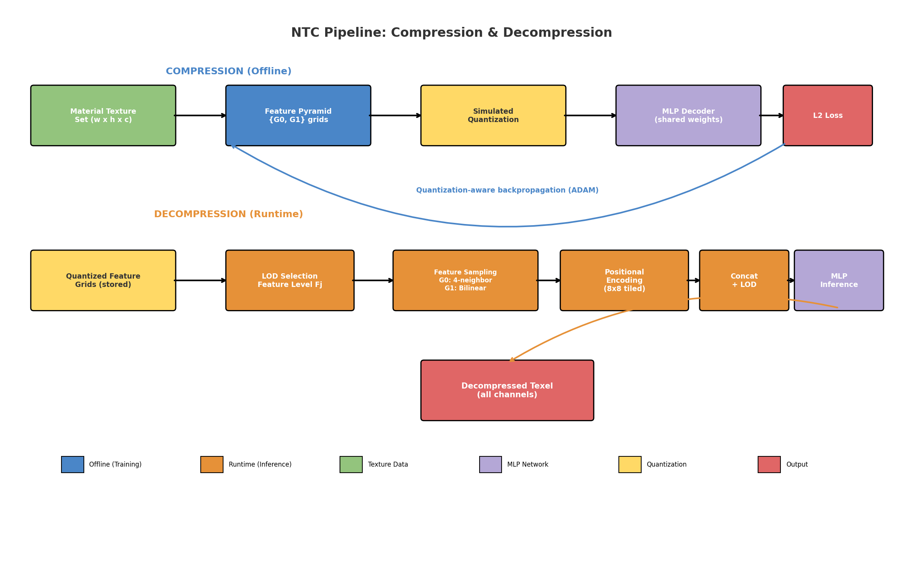

# NTCinUnity 技术报告

## 1. 项目目标

NTC（Neural Texture Compression）把同一材质的多个通道联合编码为量化 latent 金字塔和一个小型 MLP。离线阶段优化 latent 与网络参数；运行时根据 texel 位置和 mip 信息，从 latent 中取特征并执行 MLP，重建 BaseColor、Normal、Metalness、Smoothness、AO、Alpha 等通道。

NTCinUnity 解决的是引擎接入问题，而不是重新训练一套 NTC：

1. Unity Editor 如何把真实材质整理成 RTXNTC manifest；
2. 如何调用 NVIDIA `ntc-cli` 生成 `.ntc`；
3. 如何在不链接 LibNTC 的情况下读取 NTEX 容器；
4. 如何把 latent 和 MLP 参数上传到 Unity GPU 资源；
5. 如何同时提供整图解压与分块缓存两条渲染路径；
6. 如何定位真实资产中的坐标、通道、色彩空间与遮罩问题。



## 2. 系统边界

仓库分成三部分：

```text
nvidia-backend/   NVIDIA 官方 RTXNTC submodule
unity-plugin/     本项目的 Unity Runtime / Editor / Shader

docs/             设计、用法与验证记录
```

NVIDIA backend 负责训练与压缩。Unity 插件不复制其训练代码，也不在 Player 里加载 `libntc.dll`。两边只通过 `.ntc` 文件衔接。

```text
[Unity Editor]
材质 / 贴图
    -> NtcBakeWindow
    -> PNG + manifest
    -> ntc-cli (外部进程)
    -> .ntc

[Unity Runtime]
.ntc
    -> NtcContainerReader
    -> NtcAssetBuilder
    -> NtcDecompressor / NtcTileStreamer
    -> URP Material
```

这个边界带来两个直接结果：

- 烘焙机需要 `ntc-cli`，运行时不需要；
- NVIDIA SDK 可以独立升级，但 NTEX JSON 字段或网络布局变化时，Unity Reader 仍要同步验证。

## 3. 离线烘焙

### 3.1 材质扫描

`NtcBakeWindow` 可以扫描场景或项目材质。URP 常见属性的采集规则包括：

- BaseMap / MainTex -> Color；
- BumpMap -> Normal；
- OcclusionMap -> AO；
- MetallicGlossMap.R -> Metalness；
- MetallicGlossMap.A -> Smoothness；
- 开启 Alpha Clip 时，BaseMap.A -> AlphaMask。

当材质没有直接引用贴图时，可以设置一个 `Assets/` 下的约定搜索目录。该目录默认留空。

### 3.2 manifest

每个输出纹理都声明 name、channelSwizzle、isSRGB、bcFormat 和 semantics。标量数据用 BC4，RGB 数据用 BC7。

Smoothness 的 semantic 使用 `Glossiness`，因为源值是 `1 - roughness`；Runtime 虽然按 name 匹配、不读取这个 semantic，但正确元数据能避免 NTCExplorer 等外部工具把它反向理解。

### 3.3 格式转换

Unity 项目中的源图可能是 TIFF 或 packed map，而 `ntc-cli` 需要独立 PNG。因此 Bake Window 会借助 Python/Pillow：

- 把源图转为 PNG；
- 从 MetallicGlossMap 拆出 R 与 A；
- 从 BaseMap 提取 cutout alpha；
- 保留每个输出的线性/sRGB 定义。

Photoshop TIFF 的 `ExtraSamples=UNSPECIFIED` 会导致 Pillow 隐藏第 4 通道。转换代码对 `RGBX/RGBXX` raw mode 做兼容处理，否则 Smoothness 和 Alpha 会被静默丢弃。

### 3.4 压缩参数

默认 16 bpp，UI 限制到 20 bpp。RTXNTC 的已知 latent shape 表超过 20 时不能选择形状，继续提高 UI 上限没有意义。

Metalness 和 Smoothness 使用单独的 `lossFunctionScale`。该参数不增加文件大小，只重新分配材质各通道共享的训练损失权重。默认 24 与 16 来源于实际 mask 对比，详见 [`验证记录.md`](验证记录.md)。

命令必须使用：

```text
--gdeflate off
```

Unity Reader 只支持未压缩 BufferView。

## 4. NTEX 容器读取

### 4.1 Header

`NtcContainerReader` 按 little-endian 读取：

```text
byte[4]  signature = "NTEX"
uint32   containerVersion
uint64   jsonOffset
uint64   jsonSize
uint64   dataOffset
uint64   dataSize
```

总长 40 字节。

### 4.2 JSON 与 Data Chunk

JSON 描述纹理集合、颜色空间、通道范围、color mip、neural mip、MLP、权重布局和 BufferView。Data Chunk 保存实际 latent 与网络参数。

项目使用自己的最小 JSON parser，避免给 Runtime 增加第三方 JSON 包。Reader 输出普通 C# 对象和原始 Data Chunk，不创建 UnityEngine 资源，因此容器层可以独立测试。

`GetViewBytes()` 会先检查 BufferView 的 compression。只要不是 `None` 就抛出明确异常并要求重烤，而不是把压缩字节误当成原始 latent。

## 5. GPU 资产构建

### 5.1 Latent

RTXNTC 文件中的 latent 是 4 bit/channel 的 BGRA4 数据。`NtcAssetBuilder` 手动拆分每个 16 bit texel 的四个 nibble，展开到线性 RGBA32 `Texture2DArray`，以适配 Unity 2021.3 的资源绑定。

展开后的通道已经按网络需要的物理 nibble 顺序排列，不能继续套用官方硬件 BGRA 采样之后的 `.bgra` 补偿，否则会二次交换通道。

### 5.2 MLP

插件使用 INT8 网络数据。测试文件的拓扑为：

```text
48 -> 64 -> 48 -> 32 -> 16
```

隐藏层使用 HGELUClamp，最后一层输出最多 16 个材质通道。权重、scale、bias 拼成 Raw `ComputeBuffer`；网络偏移和 color mip 常量从容器描述读取，不能假设所有文件都固定相同布局。

### 5.3 PBR 通道布局

`BuildPbrLayout()` 按 texture name 匹配：

```text
Color / BaseColor / Albedo / Diffuse
Normal
Metal / Metalness / Metallic
Smooth / Gloss
Rough
AO / Occlusion / AmbientOcclusion
Alpha / Cutout / Opacity
```

Roughness 会在 shader 中转换成 Smoothness。缺失通道的索引为 -1，compute 输出使用安全默认值。

## 6. GPU 解压

`NtcDecompress.compute` 同时服务 on-Load 与 tile cache。两条路径共用同一套 MLP 数学和通道映射，区别只是输出区域。

### 6.1 on-Load

`DecompressFull()` 为 BaseColor、Normal、Mask 和 AO 分配完整目标 RenderTexture，执行 mip 0 整图解压，然后生成 mip 链。解压后的贴图绑定到原 URP 材质 clone。

这条路径适合验证：如果 Original 正常而 on-Load 错，问题集中在容器、MLP、坐标、色彩空间或 PBR 通道，不需要先查流送。

### 6.2 on-Sample tile cache

on-Sample 默认路径使用 compute tile cache：

1. 按目标最长边限制选择一个 color mip；
2. 为该 mip 一次性分配整张 PBR cache；
3. 每帧检查材质关联 Renderer 是否可见；
4. 按距相机最近排序；
5. 在预算内逐块调用 `DecompressRegion()`；
6. 全部 tile 完成后生成 mip；
7. 材质长期不可见时释放整张 cache。

默认参数：

```text
TileSize               256
CapResolution          1024
BudgetTilesPerFrame    8
EvictAfterSeconds      5
```

这里的“按需”是**材质级可见性 + 分帧 tile 调度**，不是屏幕空间的 tile 级可见性，也不是稀疏纹理页。cache 在开始处理该材质时整张分配，所以显存统计必须包含它。

tile cache 没有 resident mask。首个 tile 完成后材质即可绑定整张 cache，未填充区域没有缺页替代图。

### 6.3 fragment MLP 回退

`NtcInferenceOnSample_URP.shader` 在 compute/tile 路径不可用时可以直接从 fragment 执行 MLP。但它固定使用 color mip 0，只输出 BaseColor RGB，alpha 为 1，并且是 Unlit。

该 shader 用于数学正确性和兼容性回退，不承担完整 PBR on-Sample 渲染。

## 7. 材质绑定

on-Load 和 tile cache 最终都尽量复用原 URP 材质 clone，替换以下贴图：

```text
_BaseMap
_BumpMap
_MetallicGlossMap
_OcclusionMap
```

绑定 MetallicGlossMap 时必须启用 `_METALLICSPECGLOSSMAP`，Alpha Cutout 需要 `_ALPHATEST_ON` 和有效的 BaseColor alpha。只 SetTexture 而不设置 keyword，URP 可能继续走标量分支，看起来就像解压结果没有生效。

调试视图提供 Lit、Base、Normal、Metal、Rough。调试 shader 的逻辑必须和 URP 的真实分支一致，否则它会制造只在 debug 视图里出现的假问题。

## 8. 场景控制

`NtcSceneController` 扫描所有 Renderer，按材质名建立组并保存原始材质。进入不同模式时按组延迟加载，重任务拆到多个 frame，避免一次切换所有材质造成长时间冻结。

场景扫描读取 `Renderer.sharedMaterial`，没有遍历 `sharedMaterials[]`；同名材质归入同一组。

## 9. 路径与 Player 集成

数据路径转换为：

```csharp
Path.Combine(Application.dataPath, assetsRelative)
```

该实现读取 Editor 工程中的 `Assets/NtcPlugin/NtcData`。`.ntc` 没有 Unity importer，在普通 Assets 子目录中不会自动进入 Player；Player 环境中的 `Application.dataPath` 指向游戏数据目录，而不是工程 Assets。

Player 集成需要提供独立的数据分发层：

- StreamingAssets、Addressables 或自定义 importer；
- 与目标平台匹配的同步或异步读取接口；
- 分离数据目录解析与 `.ntc` 文件解析；
- Android/WebGL 使用 `UnityWebRequest` 等平台读取接口；
- 将 `Shader.Find` 使用的 shader 加入构建引用，避免裁剪。

Player 运行时不依赖 `ntc-cli.exe`、CUDA 或 `libntc.dll`；`.ntc` 数据仍需由项目的资源分发方案提供。

## 10. 设计约束

### Latent swizzle

数据格式发生变化后，官方 shader 中用于补偿硬件格式的 swizzle 不能原样保留。先确定内存字节、Unity 纹理格式和 shader 返回通道，再决定是否需要重排。

### 坐标方向

latent 采样、位置编码和训练坐标是一个整体。V 轴转换应放在最终输出或最终查询边界，不要插进网络内部。

### Mask 训练权重

共享 bitrate 不会公平照顾每个通道。二值 mask 应通过统计量验证，不要只看整体 PSNR。`lossFunctionScale` 是预算分配工具，不是“越大越好”的质量滑块。

### Alpha 全链路

Alpha Cutout 涉及材质识别、源图读取、manifest、容器通道、compute 输出和 URP keyword。任何一层缺失都会变成不透明方板，Runtime 无法补出烘焙时根本没有的通道。

### Debug 视图

调试工具本身也需要对齐真实 shader。仅在调试视图出现的差异，应先验证 debug 分支，而不是立即归因于 NTC。

## 11. 功能限制

- 渲染集成面向 URP，未实现 HDRP 适配；
- 未提供 asmdef 和 UPM package；
- Player 数据分发需要由宿主工程接入；
- Renderer 多材质槽未完整处理；
- tile cache 无缺页遮罩；
- cache 按整张目标纹理分配，不使用 sparse residency；
- 资源跨模式保留，需要由控制器管理生命周期；
- fragment 回退只支持 BaseColor Unlit；
- 不支持 GDeflate BufferView；
- DP4A/CoopVec 优化路径未接入 Unity 渲染管线。

## 12. 参考

- NVIDIA RTXNTC: <https://github.com/NVIDIA-RTX/RTXNTC>
- NVIDIA NTC project page: <https://research.nvidia.com/labs/rtr/neural_texture_compression/>
- Vaidyanathan et al., *Random-Access Neural Compression of Material Textures*, SIGGRAPH 2023.

许可证和代码归属见仓库根目录 [`THIRD-PARTY-NOTICES.md`](../THIRD-PARTY-NOTICES.md)。
